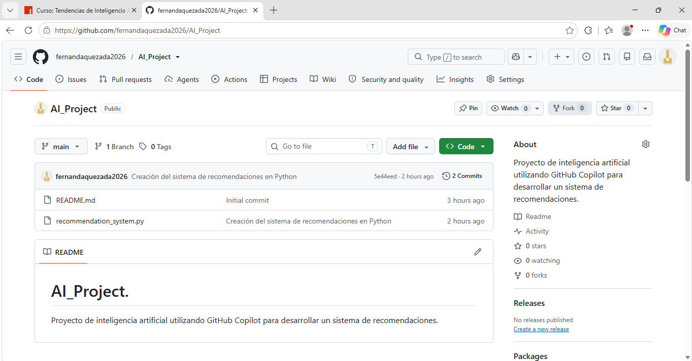
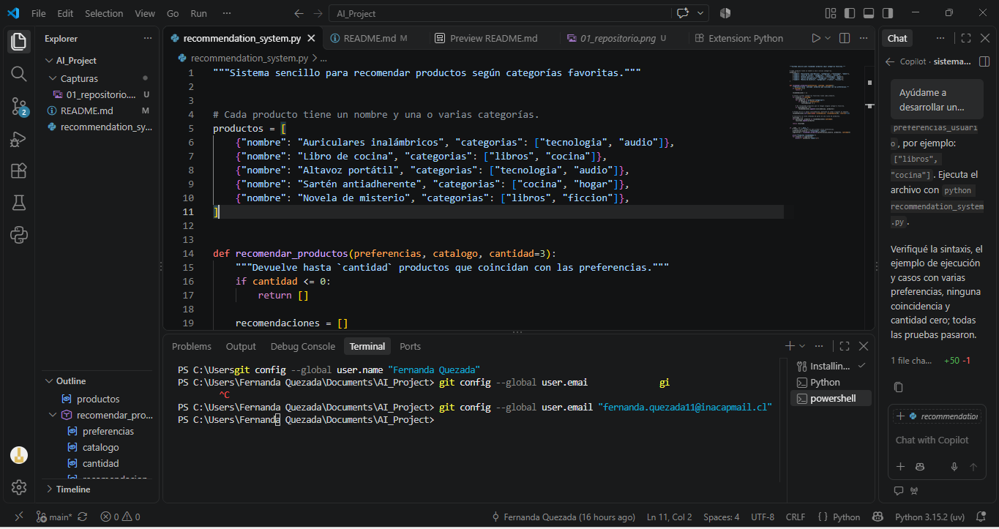
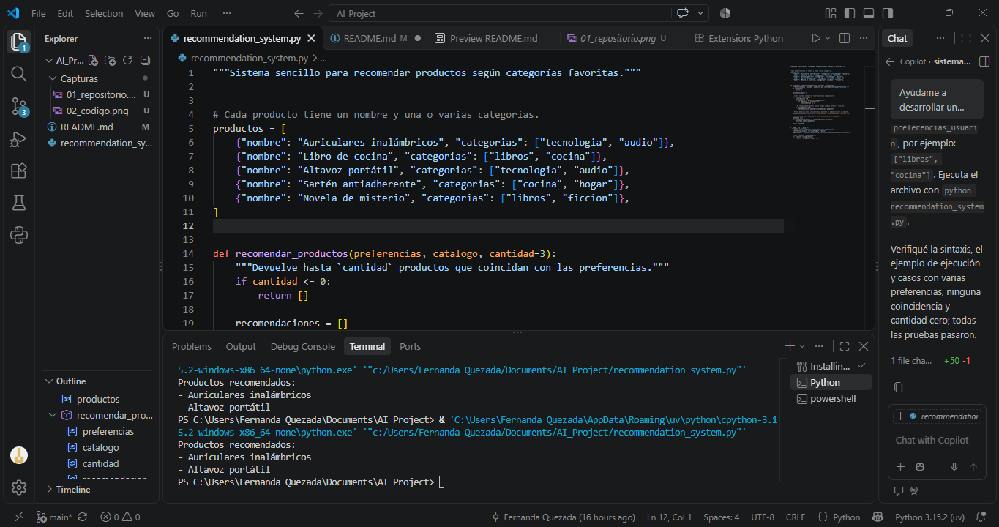

# AI_Project.
Proyecto de inteligencia artificial utilizando GitHub Copilot para desarrollar un sistema de recomendaciones.
## 1. Introducción

Este proyecto tiene como finalidad desarrollar un sistema sencillo de recomendaciones de productos utilizando Python y GitHub Copilot. El objetivo es aprender a utilizar herramientas de inteligencia artificial para facilitar la programación y crear un sistema que recomiende productos según las preferencias de los usuarios.

## 2. Creación del repositorio en GitHub

Primero ingresé a GitHub y creé un repositorio público llamado AI_Project, donde se almacenarán los archivos del proyecto. También incorporé un archivo README.md para documentar el proceso de desarrollo.
### Evidencia: Creación del repositorio

## 3. Instalación y configuración de herramientas

Para desarrollar el proyecto utilicé las siguientes herramientas:

- **GitHub:** para almacenar y administrar el proyecto.
- **Visual Studio Code:** para crear y editar el código.
- **Python:** lenguaje de programación utilizado para desarrollar el sistema.
- **Git:** para guardar y subir los cambios al repositorio.
- **GitHub Copilot:** herramienta de inteligencia artificial que me ayudó a generar el código.

Posteriormente, cloné el repositorio de GitHub en Visual Studio Code y configuré las herramientas necesarias.

## 4. Desarrollo del sistema con GitHub Copilot

Dentro de Visual Studio Code creé un archivo llamado recommendation_system.py.

Luego utilicé GitHub Copilot y le solicité que desarrollara un sistema sencillo de recomendaciones de productos en Python, con comentarios en español y un código fácil de comprender.

GitHub Copilot generó un programa que contiene distintos productos organizados por categorías, como tecnología, libros y cocina.
### Evidencia: Código del sistema de recomendaciones

## 5. Funcionamiento del sistema

El sistema funciona comparando las preferencias del usuario con las categorías de los productos disponibles.s

Cuando encuentra coincidencias, selecciona los productos relacionados y los muestra como recomendaciones.

De esta manera, el programa permite obtener sugerencias de productos según los intereses del usuario.

## 6. Ejecución y prueba del programa

Una vez generado el código, ejecuté el archivo recommendation_system.py desde Visual Studio Code.

El programa funcionó correctamente y mostró los siguientes productos recomendados:

- Auriculares inalámbricos.
- Altavoz portátil.

Esta prueba permitió comprobar que el sistema puede identificar productos relacionados con las preferencias establecidas.
### Evidencia: Ejecución del sistema

## 7. Commit y Push a GitHub

Después de comprobar el funcionamiento del programa, configuré mi nombre y correo electrónico en Git.

Posteriormente, realicé un Commit con el mensaje "Creación del sistema de recomendaciones en Python".

Finalmente, utilicé la opción Sync Changes de Visual Studio Code para subir los cambios al repositorio de GitHub.

## 8. Evidencias del proceso

En esta sección se incorporaron capturas de pantalla que muestran las principales etapas del proyecto:

-Creación del repositorio en GitHub.

-Desarrollo del código del sistema de recomendaciones con GitHub Copilot.

-Ejecución y prueba del sistema de recomendaciones.

## 9. Conclusión

La realización de este proyecto me permitió conocer y utilizar herramientas como GitHub, Visual Studio Code, Python y GitHub Copilot.

Además, aprendí cómo la inteligencia artificial puede ayudar en la creación de programas y facilitar el desarrollo de un sistema sencillo de recomendaciones de productos.